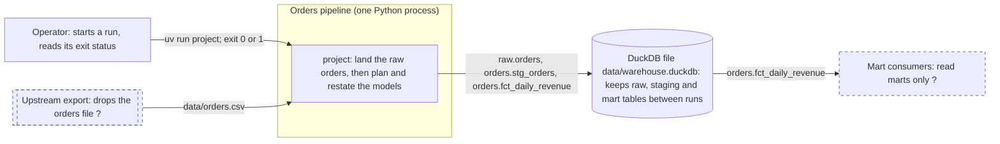
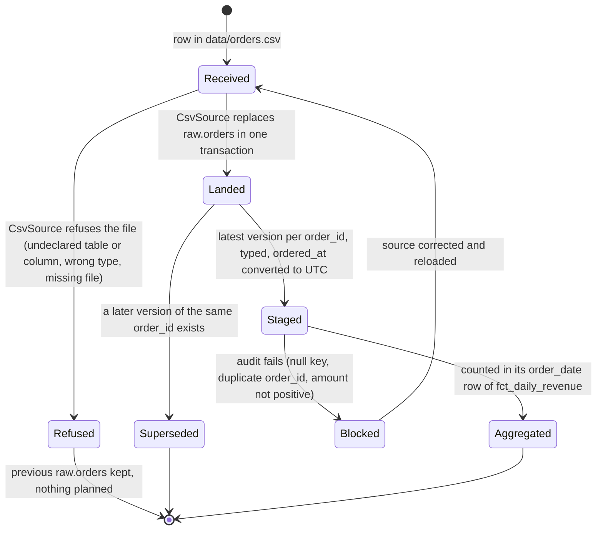
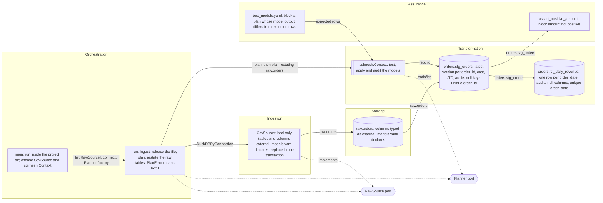

# Design: Orders pipeline

Mode: **Document**, size **Standard**, derived from the code at `a8a9a5b` on 2026-10-18 with design-spec's document mode. Items
marked *inferred* (in diagrams: a label ending in ` ?` with a dashed border) were deduced from the code; confirm or correct them.
`path:line` references are relative to the repository root. Decisions cited as Dn are recorded in the bodies of
[PR #1](https://github.com/CarlosSolrac/template-sqlmesh-duckdb/pull/1) (D2) and
[PR #2](https://github.com/CarlosSolrac/template-sqlmesh-duckdb/pull/2) (D4–D13).

This repository is the reference skeleton of a SQLMesh + DuckDB batch pipeline: a CSV of orders is landed as a typed raw table, two
SQL models turn it into daily revenue, and one composition root runs both steps.

## 1. Size and numbers

- Classification: **Standard**. Three layers (ingestion adapter, SQLMesh models, composition root) around two Protocols, in one
  process. Pipeline source: 228 lines of Python in `src/project/` and 39 lines of SQL in `models/` and `audits/`, plus 14 lines of
  SQLMesh configuration (`config.yaml`, `external_models.yaml`). Tests: 314 lines of Python and 25 of YAML. `tools/` holds 1,599 lines of
  vendored python-code-standards checks, which are not part of the pipeline. Counted with
  `git ls-files -z -- '<dir>/*.py' '<dir>/*.sql' | xargs -0 cat | wc -l`.
- External systems: two, the input file drop (`data/orders.csv`) and the DuckDB warehouse file (`data/warehouse.duckdb`), so the spec
  has a context view (D12).
- Volume: sample data only, 4 raw rows in `tests/fixtures/orders.csv:2-5` (3 orders over 2 days). Production row volume, growth rate
  and refresh frequency are unknown (open question 1).
- What the numbers would decide: both models are `kind FULL` (`models/staging/stg_orders.sql:3`, `models/marts/fct_daily_revenue.sql:3`)
  and the raw table is replaced on every run ([ADR-0002](adr/ADR-0002-replace-and-restate.md)), so each run reads the whole history.
  Run time grows linearly with total rows; ADR-0002 names incremental models as the change once the numbers call for it.

## 2. Context view

The `sqlmesh` CLI (`uv run sqlmesh plan ...`) opens the same warehouse file to diagnose a failed run; it is a second way in, not a
second process of the pipeline. Paths are relative to the project directory, which `main()` makes the working directory for the run
(`src/project/main.py:29`, D9).

## 3. Container view

Not applicable: the pipeline is one process (container views are for Large systems).

## 4. Domain states

*Inferred* from the adapter, the models and the audits. Concepts: an **order** (key `order_id`; a new `ordered_at` is a new version
of it) and a **daily revenue** row (key `order_date`).

A blocked run leaves the failing rows in `orders.stg_orders` and the mart at its last good rows (section 12, allowed exceptions). An
order with a NULL `amount` reaches *Aggregated* without failing any audit (finding 1).

## 5. Components

| node | source |
|---|---|
| Main | `src/project/main.py:19-34`: working directory `src/project/main.py:29`, creates `data/` `src/project/main.py:31`, chooses `CsvSource` `src/project/main.py:33` and `Context` `src/project/main.py:34` |
| Run | `src/project/main.py:37-58`; `ingest` closes the connection before SQLMesh opens the file `src/project/main.py:61-70`; `transform` plans, then restates `src/project/main.py:73-85`; `PlanError` → 1 `src/project/main.py:55-57` |
| Csv | `src/project/adapters/csv_source.py:16-53`: declared tables and their column types `src/project/adapters/csv_source.py:68-83`, `<schema>.<table>` names only `src/project/adapters/csv_source.py:86-96`, undeclared columns refused `src/project/adapters/csv_source.py:40-43`, one transaction `src/project/adapters/csv_source.py:44-52` |
| RawSource | `src/project/ports.py:9-19` |
| Planner | `src/project/ports.py:22-35`; `sqlmesh.Context` passed where a `Planner` is expected, `src/project/main.py:34` |
| Context | `config.yaml:1-8` (DuckDB at `data/warehouse.duckdb`, relative to the working directory, D9); runs `tests/` before every plan, SQLMesh's default (`skip_tests=False`) |
| Stg | `models/staging/stg_orders.sql:1-18`: grain `models/staging/stg_orders.sql:4`, audits `models/staging/stg_orders.sql:5-9`, casts `models/staging/stg_orders.sql:13-16`, latest version `models/staging/stg_orders.sql:18` |
| Fct | `models/marts/fct_daily_revenue.sql:1-16`: grain `models/marts/fct_daily_revenue.sql:4`, audits `models/marts/fct_daily_revenue.sql:5-8`, casts `models/marts/fct_daily_revenue.sql:12-14` |
| PositiveAudit | `audits/assert_positive_amount.sql:1-5`, attached at `models/staging/stg_orders.sql:8` |
| ModelTests | `tests/test_models.yaml:1-25` |
| Raw | `external_models.yaml:1-6` |
