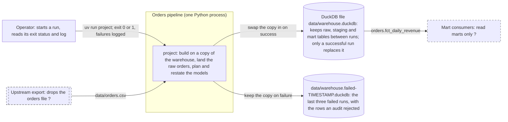
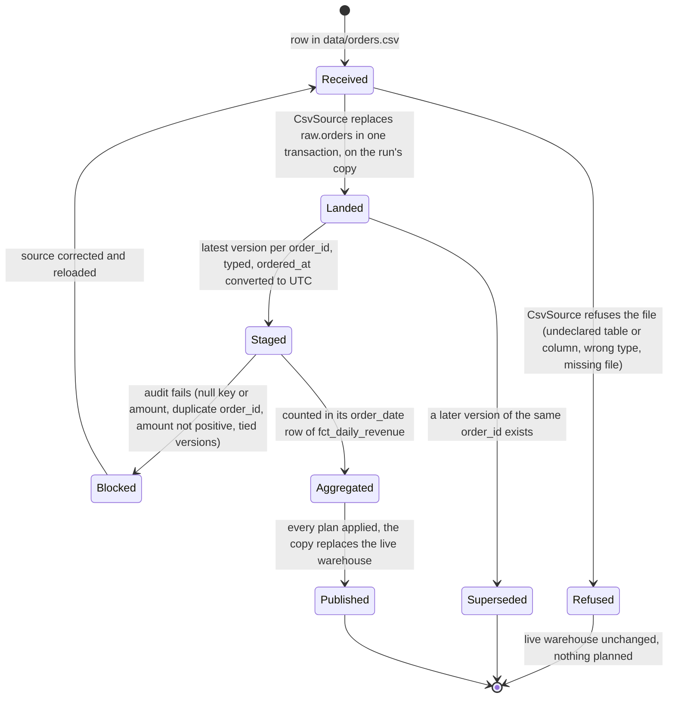
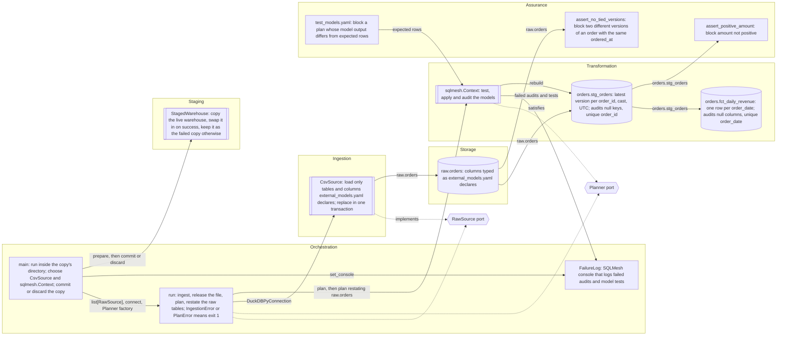
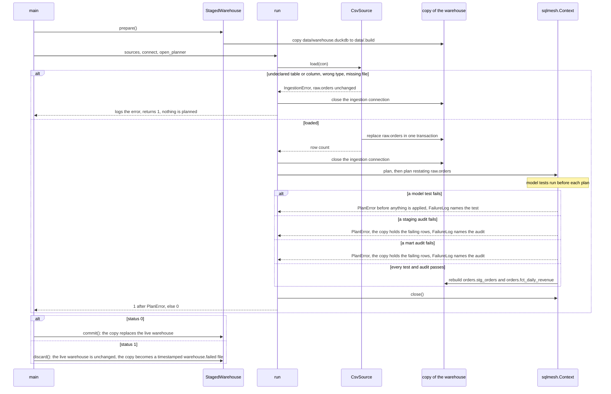

# Design: Orders pipeline

Mode: **Document**, size **Standard**, derived from the code at `a8a9a5b` on 2026-10-18 with design-spec's document mode, and updated on
2026-10-21, 2026-10-22 and 2026-10-24 (at `4177c01`) for the findings the follow-up commits closed. Items
marked *inferred* (in diagrams: a label ending in ` ?` with a dashed border) were deduced from the code; confirm or correct them.
`path:line` references are relative to the repository root. Decisions cited as Dn are recorded in the bodies of
[PR #1](https://github.com/CarlosSolrac/template-sqlmesh-duckdb/pull/1) (D2) and
[PR #2](https://github.com/CarlosSolrac/template-sqlmesh-duckdb/pull/2) (D4–D16); D4, D5, D8 and D9 have since become ADRs.

This repository is the reference skeleton of a SQLMesh + DuckDB batch pipeline: a CSV of orders is landed as a typed raw table, two
SQL models turn it into daily revenue, and one composition root runs both steps on a copy of the warehouse, which replaces the live
file only when the run succeeds.

## 1. Size and numbers

- Classification: **Standard**. Three layers (ingestion adapter, SQLMesh models, composition root) around two Protocols, in one
  process. Pipeline source: 383 lines of Python in `src/project/` and 46 lines of SQL in `models/` and `audits/`, plus 14 lines of
  SQLMesh configuration (`config.yaml`, `external_models.yaml`). Tests: 607 lines of Python, 3 of SQL and 27 of YAML. `tools/` holds
  1,599 lines of vendored python-code-standards checks, which are not part of the pipeline. Counted with
  `git ls-files -z -- '<dir>/*.py' '<dir>/*.sql' | xargs -0 cat | wc -l`.
- External systems: two, the input file drop (`data/orders.csv`) and the DuckDB warehouse file (`data/warehouse.duckdb`), so the spec
  has a context view (D12).
- Volume: sample data only, 4 raw rows in `tests/fixtures/orders.csv:2-5` (3 orders over 2 days). Production row volume, growth rate
  and refresh frequency are unknown ([TODO.md](../TODO.md) item 1).
- What the numbers would decide: both models are `kind FULL` (`models/staging/stg_orders.sql:3`, `models/marts/fct_daily_revenue.sql:3`)
  and the raw table is replaced on every run ([ADR-0002](adr/ADR-0002-replace-and-restate.md)), so each run reads the whole history.
  Every run also copies the whole warehouse file ([ADR-0007](adr/ADR-0007-build-aside-and-swap.md)). Run time and disk use grow
  linearly with total rows; ADR-0002 names incremental models as the change once the numbers call for it.

## 2. Context view



A failed run names the audit or model test that failed in its own log (`src/project/diagnostics.py:13-32`). The `sqlmesh` CLI
(`uv run sqlmesh test`, `uv run sqlmesh dag ...`) opens the same project from the repository root; it is a second way in, not a
second process of the pipeline. Paths are relative to the working directory, which `main()` sets to the build directory of the run
(`src/project/main.py:38`, [ADR-0007](adr/ADR-0007-build-aside-and-swap.md), which supersedes [ADR-0006](adr/ADR-0006-run-in-the-project-directory.md)).

## 3. Container view

Not applicable: the pipeline is one process (container views are for Large systems).

## 4. Domain states

*Inferred* from the adapter, the models and the audits. Concepts: an **order** (key `order_id`; a new `ordered_at` is a new version
of it) and a **daily revenue** row (key `order_date`).



A run blocked by any audit, staging or mart, leaves the live warehouse as it was; the rows that failed are in the run's copy, kept as
`data/warehouse.failed-<timestamp>.duckdb` ([ADR-0007](adr/ADR-0007-build-aside-and-swap.md)). An order with a NULL `amount` fails
staging's `not_null` (`models/staging/stg_orders.sql:6`), and two versions of an order with the same `ordered_at` and different content
fail `assert_no_tied_versions` (`audits/assert_no_tied_versions.sql:1-6`).

## 5. Components



| node | source |
|---|---|
| Main | `src/project/main.py:22-47`: console `src/project/main.py:34`, staged warehouse `src/project/main.py:35`, working directory is the build directory `src/project/main.py:38`, chooses `CsvSource` `src/project/main.py:39` and `Context` `src/project/main.py:40`, commit or discard `src/project/main.py:41-46` |
| Run | `src/project/main.py:50-75`; `ingest` closes the connection before SQLMesh opens the file `src/project/main.py:78-87`; `transform` plans, then restates `src/project/main.py:90-102`; `IngestionError` → 1 `src/project/main.py:67-69`; `PlanError` → 1 `src/project/main.py:72-74` |
| Log | `src/project/diagnostics.py:13-32`, installed with `set_console` at `src/project/main.py:34` |
| Staged | `src/project/adapters/staged_warehouse.py:21-83`: copy `src/project/adapters/staged_warehouse.py:52-64`, swap in `src/project/adapters/staged_warehouse.py:66-70`, keep as a timestamped failed copy and prune the oldest `src/project/adapters/staged_warehouse.py:72-83` |
| Csv | `src/project/adapters/csv_source.py:19-63`: errors become `IngestionError` `src/project/adapters/csv_source.py:39-43`, declared tables and their column types `src/project/adapters/csv_source.py:78-93`, `<schema>.<table>` names only `src/project/adapters/csv_source.py:96-106`, undeclared columns refused `src/project/adapters/csv_source.py:50-53`, one transaction `src/project/adapters/csv_source.py:54-63` |
| RawSource | `src/project/ports.py:13-27`; `IngestionError` `src/project/ports.py:9-10` |
| Planner | `src/project/ports.py:30-43`; `sqlmesh.Context` passed where a `Planner` is expected, `src/project/main.py:40` |
| Context | `config.yaml:1-8` (DuckDB at `data/warehouse.duckdb`, relative to the working directory, so the run's copy, ADR-0007); runs `tests/` before every plan, SQLMesh's default (`skip_tests=False`) |
| Stg | `models/staging/stg_orders.sql:1-19`: grain `models/staging/stg_orders.sql:4`, audits `models/staging/stg_orders.sql:5-10`, casts `models/staging/stg_orders.sql:14-17`, latest version `models/staging/stg_orders.sql:19` |
| Fct | `models/marts/fct_daily_revenue.sql:1-16`: grain `models/marts/fct_daily_revenue.sql:4`, audits `models/marts/fct_daily_revenue.sql:5-8`, casts `models/marts/fct_daily_revenue.sql:12-14` |
| PositiveAudit | `audits/assert_positive_amount.sql:1-5`, attached at `models/staging/stg_orders.sql:8` |
| TiedAudit | `audits/assert_no_tied_versions.sql:1-6`, attached at `models/staging/stg_orders.sql:9` |
| ModelTests | `tests/test_models.yaml:1-27` |
| Raw | `external_models.yaml:1-6` |

## 6. Boundary contracts

| boundary | input | output | grain/key | invariants | owner | source |
|---|---|---|---|---|---|---|
| Command line | `uv run project` | exit status and log | one run | 0 when both plans applied, and then the live warehouse is replaced; 1 on `IngestionError` (logged, nothing planned) or `PlanError` (a failing audit or model test, named in the log), and then the live warehouse is unchanged and the run's copy is kept as `data/warehouse.failed-<timestamp>.duckdb` | `main` | `pyproject.toml:16-17`, `src/project/main.py:22-47` |
| Warehouse file | the live `data/warehouse.duckdb` | a copy at `data/.build/data/warehouse.duckdb`; on success the copy replaces the live file with one `os.replace`, on failure it becomes `data/warehouse.failed-<timestamp>.duckdb` | one file | the live file is never written during a run; a leftover `.build` from an interrupted run is removed first; a leftover write-ahead log of the live file is removed on commit; the newest three failed copies are kept | `StagedWarehouse` | `src/project/adapters/staged_warehouse.py:52-83` |
| Ingestion | `data/orders.csv` with a header row | `raw.orders`: `order_id INTEGER`, `customer_id INTEGER`, `amount DECIMAL(12, 2)`, `ordered_at TIMESTAMPTZ` | one row per CSV row; raw rows before deduplication, no key | table declared in `external_models.yaml` as `<schema>.<table>` of plain identifiers; no undeclared column ([ADR-0005](adr/ADR-0005-reject-undeclared-csv-columns.md)); declared columns present with their types; replaced, never appended, in one transaction, so a failed load keeps the previous rows; every failure is an `IngestionError` | `CsvSource` | `src/project/adapters/csv_source.py:29-63`, `src/project/adapters/csv_source.py:78-106`, `external_models.yaml:1-6` |
| `RawSource` port | `duckdb.DuckDBPyConnection` | the raw table replaced; its row count as `int` | one call per raw table | `table_name` is read-only (`@property`); the table's schema matches `external_models.yaml`; a failure raises `IngestionError` | composition root | `src/project/ports.py:13-27` |
| `Planner` port | `restate_models: Iterable[str] \| None`, `no_prompts`, `auto_apply` | the plan applied to prod, or `PlanError` | one plan per call | model tests run before planning; a failing audit raises `PlanError` and skips downstream models; `close()` releases the warehouse file | composition root (`sqlmesh.Context` satisfies it, [ADR-0003](adr/ADR-0003-planner-port.md)) | `src/project/ports.py:30-43`, `src/project/main.py:90-102` |
| Staging | `raw.orders` | `orders.stg_orders` | one row per order, keyed by `order_id` (the version with the latest `ordered_at`) | every column cast; `not_null(order_id, customer_id, amount, ordered_at_utc)`; `unique_values(order_id)`; `assert_positive_amount` (rows with `amount <= 0` fail; a NULL `amount` is unknown there, so `not_null` catches it); `assert_no_tied_versions` (two versions with the same `ordered_at` and a different customer or amount fail, so deduplication never picks one silently) | `stg_orders` | `models/staging/stg_orders.sql:1-19`, `audits/assert_positive_amount.sql:1-5`, `audits/assert_no_tied_versions.sql:1-6` |
| Mart | `orders.stg_orders` | `orders.fct_daily_revenue` | one row per UTC day, keyed by `order_date` | every column cast; `not_null(order_date, order_count, revenue)`; `unique_values(order_date)` | `fct_daily_revenue` | `models/marts/fct_daily_revenue.sql:1-16` |

No HTTP API, so no OpenAPI file.

## 7. Dependency matrix

Five modules carry code (`main`, `ports`, `diagnostics`, `adapters.csv_source`, `adapters.staged_warehouse`; the two `__init__.py`
files hold only a docstring), so the matrix applies. Rows import columns; `Y` is an import the import contract allows; there is no `!`
(imported but not allowed) and no `d` (allowed but not imported) cell.

| imports ↓ / of → | main | ports | diagnostics | csv_source | staged_warehouse |
|---|---|---|---|---|---|
| main | | Y | Y | Y | Y |
| ports | | | | | |
| diagnostics | | | | | |
| csv_source | | Y | | | |
| staged_warehouse | | | | | |

No cycles. Direction: `main → adapters, diagnostics → ports`; `ports`, `diagnostics` and `staged_warehouse` import no internal module; `csv_source` imports `ports` for
`IngestionError` and satisfies `RawSource` structurally. The `main` row cites `src/project/main.py:13-16`, the `csv_source` row `src/project/adapters/csv_source.py:11`. The import contract
(`pyproject.toml:189-198`, the `import-linter` hook at `.pre-commit-config.yaml:50-56`, which CI runs through
`uv run pre-commit run --all-files`) fails the commit when an import points upward. Third-party imports (`duckdb`, `sqlmesh`,
`ruamel.yaml`; `src/project/main.py:8-11`, `src/project/ports.py:6`, `src/project/diagnostics.py:5-8`,
`src/project/adapters/csv_source.py:8-9`) are exactly the declared runtime dependencies (`pyproject.toml:10-14`), which deptry checks
on every commit (`.pre-commit-config.yaml:43-49`), with `project` declared first-party (`pyproject.toml:200-203`).

## 8. Model lineage

Not applicable: two models (the DAG starts above four); the component flowchart shows the lineage `raw.orders → orders.stg_orders →
orders.fct_daily_revenue` (`models/staging/stg_orders.sql:18`, `models/marts/fct_daily_revenue.sql:15`). No Python models.

SQLMesh's own view of the same lineage is [lineage.html](lineage.html) (models only; it loads its graph library from unpkg, so it needs
network to view), generated with `uv run sqlmesh dag docs/lineage.html` (D15). It is generated output: rerun the command whenever a
model's `FROM` changes, in the same commit.

## 9. Directory tree

```text
.
├── config.yaml                      # SQLMesh: DuckDB gateway at data/warehouse.duckdb, dialect duckdb
├── external_models.yaml             # raw table contract: names and column types (CsvSource's allowlist)
├── models/
│   ├── staging/stg_orders.sql       # latest version per order, typed, UTC; audited
│   └── marts/fct_daily_revenue.sql  # daily totals; audited
├── audits/
│   ├── assert_positive_amount.sql
│   └── assert_no_tied_versions.sql
├── src/project/
│   ├── main.py                      # composition root: main(), run(), ingest(), transform()
│   ├── ports.py                     # RawSource, Planner and IngestionError
│   ├── diagnostics.py               # FailureLog: SQLMesh console that logs failed audits and model tests
│   ├── adapters/csv_source.py       # CsvSource: the only SQL built in Python (identifier-only DDL)
│   ├── adapters/staged_warehouse.py # StagedWarehouse: copy the warehouse, swap it in on success, keep a timestamped failed copy otherwise
│   └── py.typed
├── tests/
│   ├── test_models.yaml             # SQLMesh unit tests, one per model
│   ├── test_adapters.py             # CsvSource against in-memory DuckDB
│   ├── test_staged_warehouse.py     # StagedWarehouse against files in a temporary directory
│   ├── test_model_tests.py          # every model has a unit test in test_models.yaml
│   ├── test_diagnostics.py          # FailureLog with a failed model that is not an audit
│   ├── test_main.py                 # run() with fake sources and a fake planner
│   ├── test_pipeline.py             # end-to-end runs of main() on a copy of the project
│   └── fixtures/                    # sample input and the audit the mart-failure test adds
├── docs/
│   ├── design.md                    # this file
│   ├── lineage.html                 # generated: uv run sqlmesh dag docs/lineage.html
│   └── adr/                         # decision records (section 10)
├── TODO.md                          # open items: questions, retention, mutation survivors
├── data/                            # git-ignored: orders.csv (input), warehouse.duckdb, warehouse.failed-*.duckdb, .build/
└── tools/                           # vendored python-code-standards checks, not part of the pipeline
```

## 10. Decisions

| record | what it covers |
|---|---|
| [ADR-0001](adr/ADR-0001-sqlmesh-with-exit-path.md) | SQLMesh for the transformations, pinned to `sqlmesh==0.236.2`; models stay plain DuckDB SQL (no Jinja; macros only `@this_model` in audits and the incremental time-range macros), which is the exit path to another runner |
| [ADR-0002](adr/ADR-0002-replace-and-restate.md) | adapters replace raw tables; the composition root applies model changes with `plan()`, then restates everything downstream of the raw tables, so same-day reruns pick up new rows; revisit for incremental loads |
| [ADR-0003](adr/ADR-0003-planner-port.md) | the `Planner` Protocol, which `sqlmesh.Context` satisfies, so `run()` takes fakes in unit tests (D4) |
| [ADR-0004](adr/ADR-0004-csv-source-reads-its-contract.md) | `CsvSource(table_name, path, contract)` takes its table name and column types from `external_models.yaml` (D5) |
| [ADR-0005](adr/ADR-0005-reject-undeclared-csv-columns.md) | `CsvSource` refuses CSV columns the contract does not declare (D8) |
| [ADR-0006](adr/ADR-0006-run-in-the-project-directory.md) | superseded by ADR-0007: `main()` ran in the project directory, because SQLMesh resolves the warehouse path against the working directory (D9) |
| [ADR-0007](adr/ADR-0007-build-aside-and-swap.md) | each run builds on a copy of the warehouse, inside the copy's directory, and the copy replaces the live file only when the run succeeds; the newest three failed copies are kept for inspection; a run works from any directory |

Decisions taken while building the skeleton that have no ADR:

| record | what it covers |
|---|---|
| D6, [PR #2](https://github.com/CarlosSolrac/template-sqlmesh-duckdb/pull/2) | `main(project_dir=PROJECT_DIR) -> int` as the console script; no `__main__` block |
| D10, PR #2 | sibling-relative imports inside `src/project`, because deptry does not see the package as first-party; `known_first_party = ["project"]` (`pyproject.toml:200-203`) now lets the adapter import `project.ports` |
| D15, PR #2 | `docs/lineage.html` is generated and committed |

Decisions taken in the follow-up commits, without an ADR because each is one reversible line or file:

- Tied versions of an order are rejected by an audit (`assert_no_tied_versions`), not resolved with a tie-break key, so the run never picks one silently.
- A failed run names its failing audit or model test through a SQLMesh console installed with `set_console` (`FailureLog`), replacing the README's
  restating `sqlmesh plan`, which wrote to the warehouse.
- An import-linter contract enforces the direction of section 7, because five modules make the matrix apply (rule 6).
- CI fails a change under `models/` that touches neither `tests/test_models.yaml` nor `tests/test_pipeline.py`
  (`.github/workflows/ci.yml:57-63`), and `tests/test_model_tests.py` fails when a model has no unit test.
- Failed runs are kept as `warehouse.failed-<UTC timestamp>.duckdb`, newest three, so a rerun does not erase the evidence.
- Mutation testing runs nightly and on demand (`.github/workflows/mutation.yml`, `tools/mutation.sh`) over `src/project`
  (`pyproject.toml:164-173`). It is report-only, so it is not an NFR below: it shows whether a changed model's or function's test
  still checks something, which the CI path check and `tests/test_model_tests.py` cannot. Its survivors are in [TODO.md](../TODO.md).

## 11. Non-functional requirements

Only requirements a check verifies.

| ID | Requirement | Target | Verified by |
|----|-------------|--------|-------------|
| NFR-01 | Rows that fail an audit, staging or mart, never reach the live warehouse, including an order with a NULL amount and two different versions of an order with the same `ordered_at` | a failing audit makes the run exit 1 and names the audit in the log; the live `orders.stg_orders` and `orders.fct_daily_revenue` keep their last good rows; the rejected rows are in the newest `warehouse.failed-*.duckdb` | `tests/test_pipeline.py:73-86`, `tests/test_pipeline.py:99-116`, `tests/test_pipeline.py:130-142` |
| NFR-02 | Same-day reruns process new data | a new row on an already-computed day appears in the mart | `tests/test_pipeline.py:158-165` |
| NFR-03 | A run from an empty warehouse completes | exit 0; mart equals the sample's daily totals | `tests/test_pipeline.py:64-70` |
| NFR-04 | The run does not depend on the caller's working directory ([ADR-0007](adr/ADR-0007-build-aside-and-swap.md)) | a run started outside the project, or with a relative project path, uses the project's warehouse | `tests/test_pipeline.py:36`, `tests/test_pipeline.py:168-172` |
| NFR-05 | Only declared raw tables and columns are loaded | `IngestionError` before any DDL; no schema created; exit 1 with the cause logged | `tests/test_adapters.py:58-112`, `tests/test_pipeline.py:119-127` |
| NFR-06 | A failed reload keeps the previous raw table | previous rows after a missing file or a value of the wrong type | `tests/test_adapters.py:40-56` |
| NFR-07 | Models produce the expected rows | `uv run sqlmesh test`: 2 tests pass, including a `+02` timestamp converted to UTC; SQLMesh also runs them before every plan, so each end-to-end test runs them in CI; a failing test is named in the log | `tests/test_models.yaml:1-27`, `tests/test_pipeline.py:32-33`, `tests/test_pipeline.py:89-96` |
| NFR-08 | Tests cover the code | 100% of statements and branches, whole project and changed lines | `pyproject.toml:179-187`, `.github/workflows/ci.yml:40-49` |
| NFR-09 | Strict static typing | pyright and mypy, both strict, pass | `.pre-commit-config.yaml:18-31`, `.github/workflows/ci.yml:34-35` |
| NFR-10 | No dependency with a known vulnerability | `pip-audit` passes | `.github/workflows/ci.yml:65-66` |
| NFR-11 | A failed or interrupted run leaves the live warehouse unchanged, and a later success leaves the failed copies alone | live rows equal the last good rows after a failure; no `.build` after a success, and the newest three failed copies survive it | `tests/test_staged_warehouse.py:29-133`, `tests/test_pipeline.py:145-155` |
| NFR-12 | Imports point inward | `uv run lint-imports` passes | `pyproject.toml:189-198`, `.pre-commit-config.yaml:50-56` |
| NFR-13 | Every model has a unit test | `tests/test_model_tests.py` finds no model without a test in `tests/test_models.yaml` | `tests/test_model_tests.py:12-39` |

## 12. Findings

No open findings. The seven recorded by the 2026-10-18 review and its follow-ups are fixed, and each fix is now the contract it enforces: the audits in section 6,
[ADR-0003](adr/ADR-0003-planner-port.md) to [ADR-0007](adr/ADR-0007-build-aside-and-swap.md), and NFR-01, NFR-05, NFR-11 and NFR-13.
Their history is in pull requests #1 to #5; what is still open is in [TODO.md](../TODO.md).

Allowed exceptions and rules that do not apply:

- Rule 8: `CsvSource` interpolates identifiers into DDL (`src/project/adapters/csv_source.py:56-57`) only after checking the name
  against `external_models.yaml` and the `<schema>.<table>` pattern (`src/project/adapters/csv_source.py:15`,
  `src/project/adapters/csv_source.py:47-48`); tested at `tests/test_adapters.py:73-112`.
- Rule 3: `main()` sets the console (`src/project/main.py:34`), the working directory for the run (`src/project/main.py:38`) and calls
  `StagedWarehouse` (`src/project/main.py:35-46`); all of it is wiring, and the file copying and swapping is in the adapter.
- Rule 7: no Python models.
- Rule 14: the only other diagram, `docs/lineage.html`, is generated from the models (section 8); the ADRs have none.

## 13. Class diagram

Not applicable: no Python contract is under review; the two Protocols are in section 6.

## 14. Error flow

The failure paths are the template's main promise (NFR-01, NFR-05, NFR-06, NFR-11), so they are drawn. `tests/test_main.py:77-132`
drives the same paths with fake sources and a fake planner; `tests/test_pipeline.py:64-172` drives them end to end.



## 15. Change impact

Not applicable: document mode describes the code as it is; the change-impact diagram is for restructuring in design mode.
