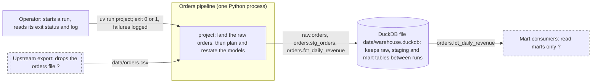
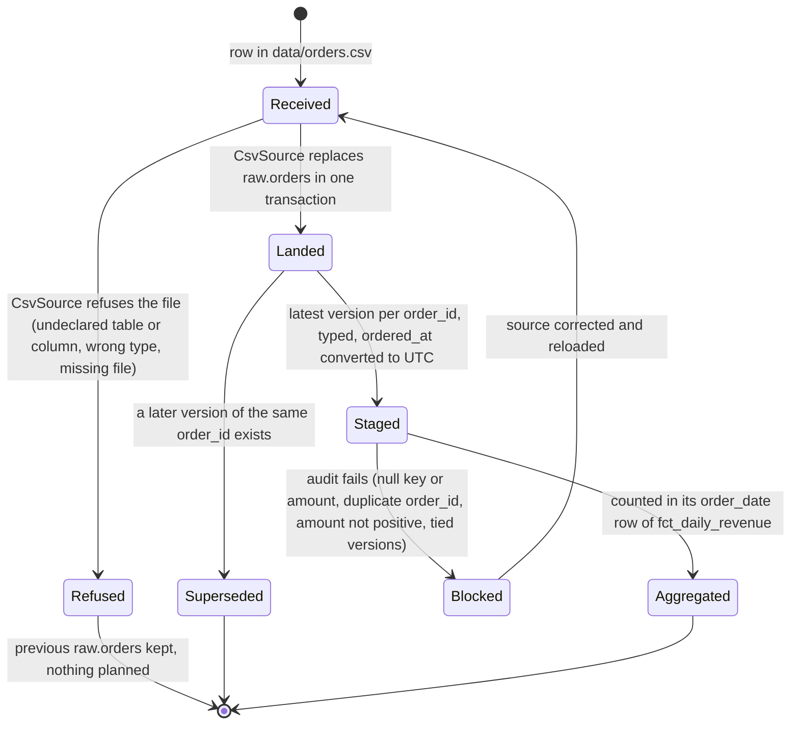
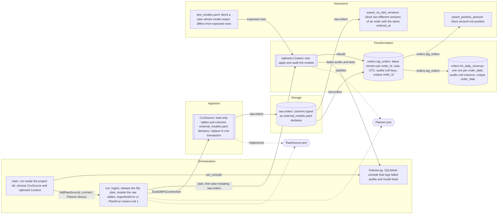
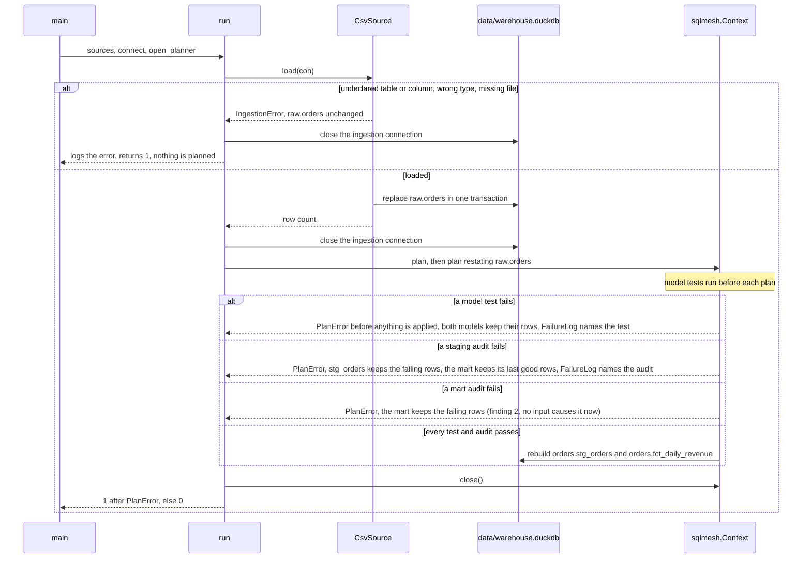

# Design: Orders pipeline

Mode: **Document**, size **Standard**, derived from the code at `a8a9a5b` on 2026-10-18 with design-spec's document mode, and updated on
2026-10-21 for the findings the follow-up commits closed. Items
marked *inferred* (in diagrams: a label ending in ` ?` with a dashed border) were deduced from the code; confirm or correct them.
`path:line` references are relative to the repository root. Decisions cited as Dn are recorded in the bodies of
[PR #1](https://github.com/CarlosSolrac/template-sqlmesh-duckdb/pull/1) (D2) and
[PR #2](https://github.com/CarlosSolrac/template-sqlmesh-duckdb/pull/2) (D4–D16); D4, D5, D8 and D9 have since become ADRs.

This repository is the reference skeleton of a SQLMesh + DuckDB batch pipeline: a CSV of orders is landed as a typed raw table, two
SQL models turn it into daily revenue, and one composition root runs both steps.

## 1. Size and numbers

- Classification: **Standard**. Three layers (ingestion adapter, SQLMesh models, composition root) around two Protocols, in one
  process. Pipeline source: 285 lines of Python in `src/project/` and 46 lines of SQL in `models/` and `audits/`, plus 14 lines of
  SQLMesh configuration (`config.yaml`, `external_models.yaml`). Tests: 390 lines of Python and 27 of YAML. `tools/` holds 1,599 lines of
  vendored python-code-standards checks, which are not part of the pipeline. Counted with
  `git ls-files -z -- '<dir>/*.py' '<dir>/*.sql' | xargs -0 cat | wc -l`.
- External systems: two, the input file drop (`data/orders.csv`) and the DuckDB warehouse file (`data/warehouse.duckdb`), so the spec
  has a context view (D12).
- Volume: sample data only, 4 raw rows in `tests/fixtures/orders.csv:2-5` (3 orders over 2 days). Production row volume, growth rate
  and refresh frequency are unknown (open question 1).
- What the numbers would decide: both models are `kind FULL` (`models/staging/stg_orders.sql:3`, `models/marts/fct_daily_revenue.sql:3`)
  and the raw table is replaced on every run ([ADR-0002](adr/ADR-0002-replace-and-restate.md)), so each run reads the whole history.
  Run time grows linearly with total rows; ADR-0002 names incremental models as the change once the numbers call for it.

## 2. Context view



A failed run names the audit or model test that failed in its own log (`src/project/diagnostics.py:13-32`). The `sqlmesh` CLI
(`uv run sqlmesh test`, `uv run sqlmesh dag ...`) opens the same project from the repository root; it is a second way in, not a
second process of the pipeline. Paths are relative to the project directory, which `main()` makes the working directory for the run
(`src/project/main.py:32`, [ADR-0006](adr/ADR-0006-run-in-the-project-directory.md)).

## 3. Container view

Not applicable: the pipeline is one process (container views are for Large systems).

## 4. Domain states

*Inferred* from the adapter, the models and the audits. Concepts: an **order** (key `order_id`; a new `ordered_at` is a new version
of it) and a **daily revenue** row (key `order_date`).



A run blocked by a staging audit leaves the failing rows in `orders.stg_orders` and the mart at its last good rows (section 12, allowed
exceptions); a run blocked by a mart audit would leave them in the mart (finding 2: staging now stops every case found, but a
mart-model bug would still land there). An order with a NULL `amount` fails staging's `not_null` (finding 1, fixed), and two versions
of an order with the same `ordered_at` and different content fail `assert_no_tied_versions` (finding 3, fixed).

## 5. Components



| node | source |
|---|---|
| Main | `src/project/main.py:21-37`: console `src/project/main.py:31`, working directory `src/project/main.py:32`, creates `data/` `src/project/main.py:34`, chooses `CsvSource` `src/project/main.py:36` and `Context` `src/project/main.py:37` |
| Run | `src/project/main.py:40-67`; `ingest` closes the connection before SQLMesh opens the file `src/project/main.py:70-79`; `transform` plans, then restates `src/project/main.py:82-94`; `IngestionError` → 1 `src/project/main.py:57-59`; `PlanError` → 1 `src/project/main.py:62-66` |
| Log | `src/project/diagnostics.py:13-32`, installed with `set_console` at `src/project/main.py:31` |
| Csv | `src/project/adapters/csv_source.py:20-65`: errors become `IngestionError` `src/project/adapters/csv_source.py:41-45`, declared tables and their column types `src/project/adapters/csv_source.py:80-95`, `<schema>.<table>` names only `src/project/adapters/csv_source.py:98-108`, undeclared columns refused `src/project/adapters/csv_source.py:52-55`, one transaction `src/project/adapters/csv_source.py:56-65` |
| RawSource | `src/project/ports.py:9-23` |
| Planner | `src/project/ports.py:26-39`; `sqlmesh.Context` passed where a `Planner` is expected, `src/project/main.py:37` |
| Context | `config.yaml:1-8` (DuckDB at `data/warehouse.duckdb`, relative to the working directory, ADR-0006); runs `tests/` before every plan, SQLMesh's default (`skip_tests=False`) |
| Stg | `models/staging/stg_orders.sql:1-19`: grain `models/staging/stg_orders.sql:4`, audits `models/staging/stg_orders.sql:5-10`, casts `models/staging/stg_orders.sql:14-17`, latest version `models/staging/stg_orders.sql:19` |
| Fct | `models/marts/fct_daily_revenue.sql:1-16`: grain `models/marts/fct_daily_revenue.sql:4`, audits `models/marts/fct_daily_revenue.sql:5-8`, casts `models/marts/fct_daily_revenue.sql:12-14` |
| PositiveAudit | `audits/assert_positive_amount.sql:1-5`, attached at `models/staging/stg_orders.sql:8` |
| TiedAudit | `audits/assert_no_tied_versions.sql:1-6`, attached at `models/staging/stg_orders.sql:9` |
| ModelTests | `tests/test_models.yaml:1-27` |
| Raw | `external_models.yaml:1-6` |

## 6. Boundary contracts

| boundary | input | output | grain/key | invariants | owner | source |
|---|---|---|---|---|---|---|
| Command line | `uv run project` | exit status and log | one run | 0 when both plans applied; 1 on `IngestionError` (logged, nothing planned) or `PlanError` (a failing audit or model test, named in the log), the mart at its last good rows unless its own audit failed, which no input found can now cause (finding 2) | `main` | `pyproject.toml:16-17`, `src/project/main.py:21-67` |
| Ingestion | `data/orders.csv` with a header row | `raw.orders`: `order_id INTEGER`, `customer_id INTEGER`, `amount DECIMAL(12, 2)`, `ordered_at TIMESTAMPTZ` | one row per CSV row; raw rows before deduplication, no key | table declared in `external_models.yaml` as `<schema>.<table>` of plain identifiers; no undeclared column ([ADR-0005](adr/ADR-0005-reject-undeclared-csv-columns.md)); declared columns present with their types; replaced, never appended, in one transaction, so a failed load keeps the previous rows; every failure is an `IngestionError` | `CsvSource` | `src/project/adapters/csv_source.py:31-65`, `src/project/adapters/csv_source.py:80-108`, `external_models.yaml:1-6` |
| `RawSource` port | `duckdb.DuckDBPyConnection` | the raw table replaced; its row count as `int` | one call per raw table | `table_name` is read-only (`@property`); the table's schema matches `external_models.yaml`; a failure raises `IngestionError` | composition root | `src/project/ports.py:9-23` |
| `Planner` port | `restate_models: Iterable[str] \| None`, `no_prompts`, `auto_apply` | the plan applied to prod, or `PlanError` | one plan per call | model tests run before planning; a failing audit raises `PlanError` and skips downstream models; `close()` releases the warehouse file | composition root (`sqlmesh.Context` satisfies it, [ADR-0003](adr/ADR-0003-planner-port.md)) | `src/project/ports.py:26-39`, `src/project/main.py:82-94` |
| Staging | `raw.orders` | `orders.stg_orders` | one row per order, keyed by `order_id` (the version with the latest `ordered_at`) | every column cast; `not_null(order_id, customer_id, amount, ordered_at_utc)`; `unique_values(order_id)`; `assert_positive_amount` (rows with `amount <= 0` fail; a NULL `amount` fails `not_null`, finding 1, fixed); `assert_no_tied_versions` (two versions with the same `ordered_at` and a different customer or amount fail, finding 3, fixed) | `stg_orders` | `models/staging/stg_orders.sql:1-19`, `audits/assert_positive_amount.sql:1-5`, `audits/assert_no_tied_versions.sql:1-6` |
| Mart | `orders.stg_orders` | `orders.fct_daily_revenue` | one row per UTC day, keyed by `order_date` | every column cast; `not_null(order_date, order_count, revenue)`; `unique_values(order_date)` | `fct_daily_revenue` | `models/marts/fct_daily_revenue.sql:1-16` |

No HTTP API, so no OpenAPI file.

## 7. Dependency matrix

Not applicable: four modules carry code (`main`, `ports`, `diagnostics`, `adapters.csv_source`; the two `__init__.py` files hold only
a docstring), and the matrix starts above four. Import direction: `main → adapters.csv_source, diagnostics, ports`
(`src/project/main.py:13-15`); `ports`, `diagnostics` and `adapters.csv_source` import no internal module (`CsvSource` satisfies
`RawSource` structurally). Third-party imports (`duckdb`, `sqlmesh`, `ruamel.yaml`; `src/project/main.py:8-11`,
`src/project/ports.py:6`, `src/project/diagnostics.py:5-8`, `src/project/adapters/csv_source.py:8-9`) are exactly the declared runtime
dependencies (`pyproject.toml:10-14`), which deptry checks on every commit (`.pre-commit-config.yaml:43-49`). Below the matrix
threshold, the direction needs no import-linter contract. A fifth module would make the matrix apply.

## 8. Model lineage

Not applicable: two models (the DAG starts above four); the component flowchart shows the lineage `raw.orders → orders.stg_orders →
orders.fct_daily_revenue` (`models/staging/stg_orders.sql:18`, `models/marts/fct_daily_revenue.sql:15`). No Python models.

SQLMesh's own view of the same lineage is [lineage.html](lineage.html) (models only; it loads its graph library from unpkg, so it needs
network to view), generated with `uv run sqlmesh dag docs/lineage.html` (D15). It is generated output: rerun the command whenever a
model's `FROM` changes, in the same commit.

## 9. Directory tree

```text
.
├── config.yaml                      # SQLMesh: DuckDB gateway at data/warehouse.duckdb, dialect duckdb
├── external_models.yaml             # raw table contract: names and column types (CsvSource's allowlist)
├── models/
│   ├── staging/stg_orders.sql       # latest version per order, typed, UTC; audited
│   └── marts/fct_daily_revenue.sql  # daily totals; audited
├── audits/
│   ├── assert_positive_amount.sql
│   └── assert_no_tied_versions.sql
├── src/project/
│   ├── main.py                      # composition root: main(), run(), ingest(), transform()
│   ├── ports.py                     # Protocols only: RawSource, Planner
│   ├── diagnostics.py               # FailureLog: SQLMesh console that logs failed audits and model tests
│   ├── adapters/csv_source.py       # CsvSource and IngestionError; the only SQL built in Python (identifier-only DDL)
│   └── py.typed
├── tests/
│   ├── test_models.yaml             # SQLMesh unit tests, one per model
│   ├── test_adapters.py             # CsvSource against in-memory DuckDB
│   ├── test_diagnostics.py          # FailureLog with a failed model that is not an audit
│   ├── test_main.py                 # run() with fake sources and a fake planner
│   ├── test_pipeline.py             # end-to-end runs of main() on a copy of the project
│   └── fixtures/orders.csv          # sample input
├── docs/
│   ├── design.md                    # this file
│   ├── lineage.html                 # generated: uv run sqlmesh dag docs/lineage.html
│   └── adr/                         # decision records (section 10)
├── data/                            # git-ignored: orders.csv (input), warehouse.duckdb
└── tools/                           # vendored python-code-standards checks, not part of the pipeline
```

## 10. Decisions

| record | what it covers |
|---|---|
| [ADR-0001](adr/ADR-0001-sqlmesh-with-exit-path.md) | SQLMesh for the transformations, pinned to `sqlmesh==0.236.2`; models stay plain DuckDB SQL (no Jinja; macros only `@this_model` in audits and the incremental time-range macros), which is the exit path to another runner |
| [ADR-0002](adr/ADR-0002-replace-and-restate.md) | adapters replace raw tables; the composition root applies model changes with `plan()`, then restates everything downstream of the raw tables, so same-day reruns pick up new rows; revisit for incremental loads |
| [ADR-0003](adr/ADR-0003-planner-port.md) | the `Planner` Protocol, which `sqlmesh.Context` satisfies, so `run()` takes fakes in unit tests (D4) |
| [ADR-0004](adr/ADR-0004-csv-source-reads-its-contract.md) | `CsvSource(table_name, path, contract)` takes its table name and column types from `external_models.yaml` (D5) |
| [ADR-0005](adr/ADR-0005-reject-undeclared-csv-columns.md) | `CsvSource` refuses CSV columns the contract does not declare (D8) |
| [ADR-0006](adr/ADR-0006-run-in-the-project-directory.md) | `main()` runs inside the project directory, because SQLMesh resolves the warehouse path against the working directory (D9) |

Decisions taken while building the skeleton that have no ADR:

| record | what it covers |
|---|---|
| D6, [PR #2](https://github.com/CarlosSolrac/template-sqlmesh-duckdb/pull/2) | `main(project_dir=PROJECT_DIR) -> int` as the console script; no `__main__` block |
| D10, PR #2 | sibling-relative imports inside `src/project`, because deptry does not see the package as first-party; it is also why `IngestionError` lives in `adapters/csv_source.py` and not in `ports.py` |
| D15, PR #2 | `docs/lineage.html` is generated and committed |

Decisions taken in the follow-up commits (2026-10-21), without an ADR because each is one reversible line or file:

- Tied versions of an order are rejected by an audit (`assert_no_tied_versions`), not resolved with a tie-break key, so the run never picks one silently.
- A failed run names its failing audit or model test through a SQLMesh console installed with `set_console` (`FailureLog`), replacing the README's
  restating `sqlmesh plan`, which wrote to the warehouse.

## 11. Non-functional requirements

Only requirements a check verifies.

| ID | Requirement | Target | Verified by |
|----|-------------|--------|-------------|
| NFR-01 | Rows that fail a staging audit never reach the mart (including a NULL amount, finding 1, fixed, and tied versions, finding 3, fixed) | a failing staging audit makes the run exit 1, names the audit in the log; `orders.fct_daily_revenue` keeps its last good rows | `tests/test_pipeline.py:59-68`, `tests/test_pipeline.py:81-98` |
| NFR-02 | Same-day reruns process new data | a new row on an already-computed day appears in the mart | `tests/test_pipeline.py:112-119` |
| NFR-03 | A run from an empty warehouse completes | exit 0; mart equals the sample's daily totals | `tests/test_pipeline.py:50-56` |
| NFR-04 | The run does not depend on the caller's working directory | a run started outside the project, or with a relative project path, uses the project's warehouse | `tests/test_pipeline.py:34`, `tests/test_pipeline.py:122-126` |
| NFR-05 | Only declared raw tables and columns are loaded | `IngestionError` before any DDL; no schema created; exit 1 with the cause logged | `tests/test_adapters.py:59-112`, `tests/test_pipeline.py:101-109` |
| NFR-06 | A failed reload keeps the previous raw table | previous rows after a missing file or a value of the wrong type | `tests/test_adapters.py:40-57` |
| NFR-07 | Models produce the expected rows | `uv run sqlmesh test`: 2 tests pass, including a `+02` timestamp converted to UTC; SQLMesh also runs them before every plan, so each end-to-end test runs them in CI; a failing test is named in the log | `tests/test_models.yaml:1-27`, `tests/test_pipeline.py:30-31`, `tests/test_pipeline.py:71-78` |
| NFR-08 | Tests cover the code | 100% of statements and branches, whole project and changed lines | `pyproject.toml:175-182`, `.github/workflows/ci.yml:40-49` |
| NFR-09 | Strict static typing | pyright and mypy, both strict, pass | `.pre-commit-config.yaml:18-31`, `.github/workflows/ci.yml:34-35` |
| NFR-10 | No dependency with a known vulnerability | `pip-audit` passes | `.github/workflows/ci.yml:56-57` |

## 12. Findings

1. **Rule 5, a NULL amount passed every audit (known; fixed).** `not_null` in `models/staging/stg_orders.sql:6` omitted `amount`, and
   `amount <= 0` in `audits/assert_positive_amount.sql:5` is unknown for NULL. Consequence: such an order counted in `order_count` but
   added nothing to `revenue` (`models/marts/fct_daily_revenue.sql:13-14`), silently, unless every order that day lacked an amount, which
   made `revenue` NULL and failed the mart's `not_null`. Fix: `amount` is now in `stg_orders`' `not_null` columns; the same change belongs
   in design-spec's draft. (Known: D2, PR #1.)
2. **Rule 5, a failing mart audit leaves its failing rows in the mart (new; case found fixed).** Restating a `FULL` model rebuilds its prod table in
   place, so when an audit of `orders.fct_daily_revenue` (`models/marts/fct_daily_revenue.sql:5-8`) fails, the mart already holds the
   failing rows. Reproduced on 2026-10-18 with SQLMesh 0.236.2: after a good run, a day whose only order has no amount
   made the run exit 1 and left `(2026-10-03, 1, NULL)` in the mart. Done: `amount` is in staging's `not_null`; the log message and
   docstring name the model that failed its audit (`src/project/main.py:62-66`); the end-to-end test of the case found is
   `tests/test_pipeline.py:81-88`. Still true: a mart audit that fails because of a model bug leaves its rows in the mart, and no test
   reproduces that. A fix needs a design change (build the mart aside, then swap), which is not made here.
3. **Rule 5, tied versions deduplicated arbitrarily (known; fixed).** `models/staging/stg_orders.sql:19` orders versions by
   `ordered_at` only, so two versions of an order with the same `ordered_at` and different amounts kept whichever row came first, and
   revenue depended on input row order. Fix: `assert_no_tied_versions` (`audits/assert_no_tied_versions.sql:1-6`, attached at
   `models/staging/stg_orders.sql:9`) fails the run on such a tie; tested at `tests/test_pipeline.py:91-98`. The same audit belongs in
   design-spec's draft.
4. **Rule 5, ingestion failures were not caught once per unit of work (new; fixed).** `CsvSource.load` now turns every `ValueError`
   and `duckdb.Error` into an `IngestionError` (`src/project/adapters/csv_source.py:41-45`), which `run()` logs before returning 1
   (`src/project/main.py:57-59`); tested at `tests/test_main.py:111-121` and `tests/test_pipeline.py:101-109`. An exception of any other
   type still propagates (`tests/test_main.py:124-132`), as a bug should.
5. **Rule 12, decisions without records (new; fixed).** D4, D5, D8 and D9 are now
   [ADR-0003](adr/ADR-0003-planner-port.md) to [ADR-0006](adr/ADR-0006-run-in-the-project-directory.md).
6. **Rule 11, a model change does not require a test change (new; half fixed).** The staging test now includes a `+02` timestamp, so
   the UTC conversion (`models/staging/stg_orders.sql:17`) is exercised with another offset (`tests/test_models.yaml:8`,
   `tests/test_models.yaml:13`). Still open: no check fails a change under `models/` that leaves `tests/test_models.yaml` untouched.
   Consequence: a model edit can ship with a stale test that still passes. Fix: a CI step that compares changed paths; it needs a
   change to `.github/workflows/ci.yml`, which is protected and awaits approval.

Allowed exceptions and rules that do not apply:

- Rule 5: after a staging audit fails, `orders.stg_orders` keeps the failing rows (`src/project/main.py:84-87`), and anyone who can open
  the warehouse can query them. The rule allows this only if consumers read marts only, which is *inferred*: nothing in the repository
  enforces it (open question 2).
- Rule 8: `CsvSource` interpolates identifiers into DDL (`src/project/adapters/csv_source.py:58-59`) only after checking the name
  against `external_models.yaml` and the `<schema>.<table>` pattern (`src/project/adapters/csv_source.py:13`,
  `src/project/adapters/csv_source.py:49-50`); tested at `tests/test_adapters.py:73-112`.
- Rule 3: `main()` creates the `data/` directory (`src/project/main.py:34`), sets the working directory for the run
  (`src/project/main.py:32`) and installs the SQLMesh console (`src/project/main.py:31`); all three are wiring, and it writes no file
  contents itself.
- Rule 6: no import-linter contract, which the rule needs only when the dependency matrix applies (section 7).
- Rule 7: no Python models.
- Rule 14: the only other diagram, `docs/lineage.html`, is generated from the models (section 8); the ADRs have none.

## 13. Class diagram

Not applicable: no Python contract is under review; the two Protocols are in section 6.

## 14. Error flow

The failure paths are the template's main promise (NFR-01, NFR-05, NFR-06), so they are drawn. `tests/test_main.py:78-132` drives the
same paths with fake sources and a fake planner; `tests/test_pipeline.py:50-126` drives them end to end.



## 15. Change impact

Not applicable: document mode describes the code as it is; the change-impact diagram is for restructuring in design mode.

## Open questions

1. What are the production row volume, growth rate and refresh frequency? They decide between `FULL` models with replaced raw tables
   (ADR-0002) and incremental ones.
2. Who reads the warehouse, and can they be held to marts only? After a blocked run, `orders.stg_orders` (or, finding 2, the mart)
   holds the failing rows, and nothing in the repository restricts access to it.
3. Should findings 1 and 3 be fixed in design-spec's draft too, which this template follows on behaviour (D2)? They are fixed here.
